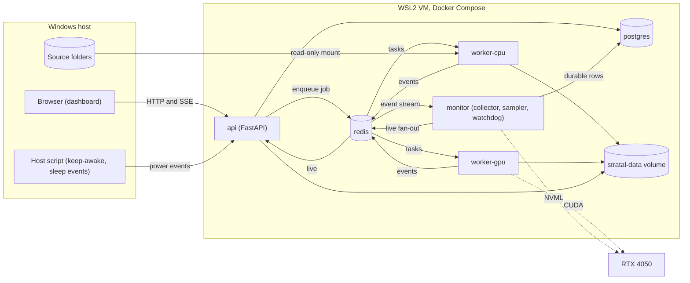
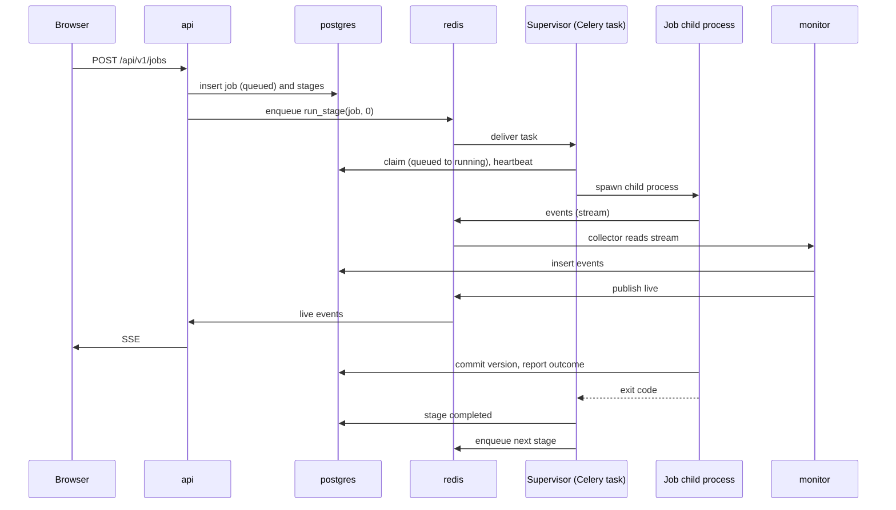
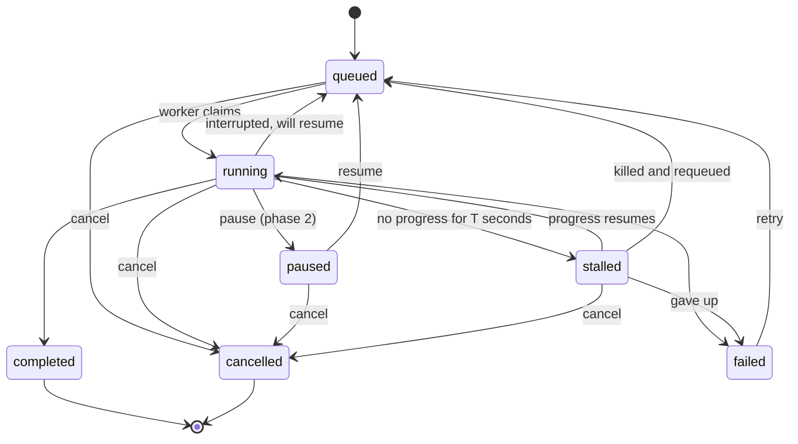

# Stratal — Architecture

| | |
|---|---|
| Status | Built through M2 (2026-11-14): storage and ingestion (M1); job runtime, events, telemetry, watchdog and host script (M2). Later stages and the UI are not built yet |
| Detail level | Phase 1 is specified. Phases 2–5 are outlined and get detailed at each phase kickoff |
| Decisions | Each major choice has an ADR in [decisions/](decisions/). This document describes the result; the ADRs hold the reasoning |

Requirement IDs refer to [SPEC.md](SPEC.md). Schemas are in [DATA_MODEL.md](DATA_MODEL.md) and interfaces in [API.md](API.md).

## 1. What shapes the design

Five facts about the target machine and the project decide most of what follows.

1. **One 6 GB GPU.** Only one large model fits at a time (RUN-1.4), and local jobs must stay under 5.5 GB (NFR-1).
2. **About 10 GB of RAM for everything.** The laptop has 15.2 GB usable and Windows needs a share, so the WSL VM is capped at 10 GB and all Stratal containers together must stay under 9 GB (NFR-2).
3. **A laptop that sleeps.** It supports only Modern Standby, which suspends the whole Linux VM mid-job (BUG4).
4. **Linux in a VM on Windows.** Everything runs in Docker on WSL2. Files on Windows drives are slow to reach from Linux, and C: is nearly full.
5. **The owner writes the core logic.** Dedupe, version hashing, splits, batching and VRAM handling, scoring and evaluation statistics are implemented by the owner (SPEC §9.1). The architecture keeps those pieces small, pure and separately testable, with the plumbing around them.

Two rules follow and recur throughout:

- **A process is the unit of cleanup.** The only unload that is guaranteed to free VRAM and RAM is the process exiting. Every job therefore runs in its own process.
- **Data is immutable and addressed by content.** Stages never hand data to each other in memory. Each one reads a version and writes a new version.

## 2. Components



| Service | Job | From | GPU | Memory limit (initial) |
|---|---|---|---|---|
| `postgres` | System of record: jobs, events, telemetry, dataset versions, lineage, reviews, reports | M0 | no | 0.5 GB |
| `redis` | Celery broker, event stream buffer, live fan-out, control flags | M0 | no | 0.25 GB |
| `api` | HTTP and SSE. Loads no models and does not import PyTorch | M0 | no | 0.4 GB |
| `worker-cpu` | CPU stages: ingest, clean, preprocess, filter, split, evaluate | M2 | no | 2.5 GB |
| `worker-gpu` | GPU stages, one at a time: label, and later training | M2 | yes | 4.5 GB |
| `monitor` | Collector (events to Postgres), sampler (psutil + NVML), watchdog (dead and stalled jobs) | M2 | NVML only | 0.25 GB |
| `frontend` | Vite dev server for the web UI (React, SPEC §7.4); proxies `/api` to `api`. Its checks run on demand in `frontend-tools` (1.5 GB, profile `dev`, like `dev`) | M6 | no | 0.4 GB |
| `beat` | Scheduled maintenance: telemetry downsampling (NFR-12) | M7 | no | 0.2 GB |
| `inference` | Long-lived process that holds at most one model for `/predict` (REG-1.4) | Phase 2 | yes | to be set |
| `ollama` | Local LLM serving (LLM-1.1) | Phase 3 | yes | to be set |
| Host script | PowerShell on Windows: keeps the laptop awake while jobs run, reports sleep and resume | M2 | – | – |

The limits sum to 9.0 GB, which is how NFR-2 is enforced. Spike S-07 ([RISKS.md](RISKS.md)) measured them while labelling 2,000 images on 2026-11-15: every container stayed under half its limit (worker-gpu 2.2 of 4.5 GB, worker-cpu 0.9 of 2.5 GB), so they are kept, with worker-gpu's headroom left for training in phase 2.

## 3. The phase-1 pipeline

A pipeline run is one **job**. It has one **stage** per step, and each stage runs in its own process on the queue that suits it.

| # | Stage | Queue | What it does | Requirements | Core logic by |
|---|---|---|---|---|---|
| 0 | `ingest` | cpu | Scan the source folder, copy files into the blob store, read metadata, reject corrupt and undersized files | DATA-1.1–1.3 | agent |
| 1 | `clean` | cpu | Mark exact duplicates and near duplicates (pHash) | DATA-2.1, 2.2 | agent, at the owner's request (ADR-0012); owner for the thresholds (OC-5) |
| 2 | `preprocess` | cpu | Write resized copies, keep originals | DATA-6.1 | agent |
| 3 | `label` | gpu | Caption each image, then CLIP-score each pair. From M11, also semantic-duplicate clusters from the same CLIP vectors ([ADR-0013](decisions/ADR-0013-semantic-duplicates.md)) | LABEL-1.1–1.3, DATA-2.3 | agent, at the owner's request (ADR-0012) |
| 4 | `filter` | cpu | Mark pairs below the CLIP threshold; validate the image–caption schema | LABEL-1.4, DATA-5.1 | agent for the rule, at the owner's request (ADR-0012); owner for the threshold (OC-5) |
| 5 | `split` | cpu | Group near-copies (12 bits), stratify, assign train / val / test carrying the previous split over, check for leaks, report | DATA-4.1–4.7 | agent, at the owner's request (ADR-0012); shell, lookup, leakage check and report by the agent |
| 6 | `evaluate` | cpu | Build the phase-1 report and store it in `eval_reports`; makes no version and passes its input on | EVAL-1.1 | agent for the statistics, at the owner's request (ADR-0012), and for the assembly |

Manual review (LABEL-1.5) is not a stage. It is a human activity attached to a version (API.md §3.5), and the report uses the version's newest closed review. A report can be built again at any time without a pipeline: `POST /versions/{id}/reports` runs `evaluate` alone, as a job of kind `report`.

**Every stage ends with a commit step**: write the manifest, compute the version ID, record lineage. This is where the "Staging" messages in MON-3 come from (OC-1, accepted by the owner on 2026-11-14).

**Stages are memoized.** Before running, a stage looks for an existing version with the same stage name, parent version and config hash. If one exists it is reused and the stage is marked skipped. Two consequences:

- A crashed pipeline resumes from the last finished stage without redoing earlier ones (NFR-5).
- Changing one setting reruns only what depends on it. A new CLIP threshold reruns `filter` and later stages, and does not caption anything again.

As built in M3, memoization applies to every stage that consumes a version (`run_derived_stage`); ingest has no parent version and always runs, which costs little because its blobs are stored by content. The config hash for the lookup comes from the same function that names versions. Owner code that changes its results bumps `ALGORITHM_VERSION`, which is part of the config, so an old version is not reused for new code.

**Expensive per-item results are cached by content.** Captions, CLIP scores, pHashes and image metadata are stored in a derivation cache keyed by the file's content hash plus the parameters that produced the result. A caption batch is committed to the cache as soon as it finishes. That is how LABEL-1.2 is met: after a kill at 60%, the restarted stage finds 60% of its work in the cache and computes only the rest.

## 4. Running a job



### 4.1 Supervisor and child

The Celery task does no real work. It is a **supervisor** that:

1. Claims the stage with a conditional update in Postgres. If the claim fails (the job was cancelled, or the message was delivered twice) it exits. Duplicate deliveries are therefore harmless.
2. Spawns the **child process** that runs the stage.
3. Sends a heartbeat every few seconds and watches for a cancel request.
4. When the child exits, records the outcome. If the child died without reporting (segfault, or killed by the kernel for using too much RAM), the supervisor reads the exit status and records a clear reason. The worker itself stays healthy.
5. Enqueues the next stage on its queue.

The child process sets up structured logging with the job and version IDs bound (NFR-10), an event emitter, and a small reporter thread for its own memory figures. It then calls the stage's code with a **job context**: the object stage code uses to emit events, report progress, and ask "should I stop?".

Postgres is the truth for job state. Celery only delivers "run this stage" messages. Tasks are acknowledged on receipt, so a Redis redelivery after a long run cannot start a second copy.

### 4.2 Job states



Any transition not drawn is rejected, and every transition is written to `job_transitions` with its reason and who caused it (RUN-1.1.AC1). A separate `desired_state` field holds a pause or cancel request until the job reaches a safe point, so the UI can show "cancelling" honestly.

Stages have their own simpler status: pending, queued, running, completed, failed, skipped, cancelled.

### 4.3 Stopping and recovering

| Situation | What happens |
|---|---|
| User cancels | `desired_state` is set and a Redis flag raised. The child stops at the next safe point. If it has not stopped after a grace period, the supervisor kills the child's process group |
| User pauses (phase 2) | Same flag. The child checkpoints and exits. Resume is a new task that starts from the checkpoint |
| Child crashes | Supervisor records `failed` with the reason. Finished stages and cached batches are kept |
| Worker container dies | The watchdog in `monitor` sees the heartbeat go stale and either requeues the job (work is resumable) or marks it failed |
| No progress for T seconds | The watchdog marks the job `stalled` (RUN-1.7, phase 2) |
| Laptop sleeps | See [§8](#8-sleep-and-suspend) |

## 5. Events and telemetry

### 5.1 Events

Stage code calls the job context. It never talks to Redis or Postgres directly.

- **Emit.** The emitter writes each event to the job's local log file and adds it to a Redis Stream from a background thread with a bounded queue. Emitting never blocks the job and never raises into it. If Redis is unreachable the job keeps running and the events remain in the local file (NFR-13).
- **Collect.** The collector reads the stream in batches, inserts into Postgres (idempotent on the event's unique ID), acknowledges, and publishes each event for live viewers. If the collector is down, events wait in the stream and are picked up when it returns. Events that never reached the stream (Redis down, or a lost entry) are backfilled from the job's local file by the supervisor after each stage, on the same unique ID, so each is stored once (M7, ADR-0005).
- **Derive.** From stage events the collector keeps each stage's row current: status, progress, latest activity message, throughput and ETA. The timeline view (MON-4.2) reads those rows instead of replaying events.
- **Deliver.** The API streams to the browser over SSE. A reconnecting client sends the last event ID it saw; the API replays the gap from Postgres and then switches to live. Live uses the same query: a pub/sub message only tells the API to read Postgres again, so nothing can be missed or sent twice. This meets the 1-second target in MON-1.4.

The event shape is the one in SPEC MON-1, plus a unique ID, an event type, and `reason` and `suggested_action`, which are required on WARN and ERROR (MON-1.3). **ETA** (MON-1.5) is remaining items divided by a moving average of throughput.

### 5.2 Telemetry

Two sources, because no single process can see everything:

| Source | Measures | Why there |
|---|---|---|
| Sampler in `monitor` | CPU overall and per core, RAM, disk I/O (psutil); GPU utilization, memory-controller %, VRAM used/total, temperature, power (NVML) | System-wide numbers, independent of any job |
| Reporter thread in the job child | The job's own RSS, and PyTorch `memory_allocated` / `memory_reserved` | Only the owning process can read its allocator (SPEC CL-11) |

The sampler runs every second while any job is active and every 10 seconds when idle (MON-2.2). It learns which job and stage are active from a small registry the supervisors maintain, and tags each sample (MON-2.3). When a stage completes, the collector computes its peaks from the samples in its time window and stores them in the job summary (MON-2.5).

Two things the dashboard must say plainly:

- RAM figures are the **WSL VM's** view, not Windows'.
- NVML "GPU utilization" is the share of time any kernel was running, not how much of the GPU was used (SPEC MON-2 interpretation note).

## 6. Storage

Everything Stratal owns lives on one Docker volume, `stratal-data`, on the Linux side.

```text
/data
├── blobs/sha256/ab/cd/<hash>     immutable files, named by content hash
├── manifests/<version_id>.parquet  one immutable manifest per dataset version
├── jobs/<job_id>/                per-job log, event spool, in-run checkpoints
├── models/<name>/<revision>/     pretrained models from the allow-list, verified by `models pull`
├── registry/                     trained weights (phase 2)
└── tmp/                          staging area for atomic writes
```

- **Ingest copies each source file into the blob store once.** After that the source folder can move or disappear without breaking any version, and later stages read from fast Linux storage. Byte-identical files have the same hash and are stored once.
- **A version is a manifest plus references.** The manifest is a Parquet file with one row per item: its content hash, status, the reason for any rejection, and the columns each stage adds. A new version costs only its manifest plus any files that did not exist before (DATA-3.4).
- **Rows are never dropped, only marked.** A manifest carries every row forward with a status (`accepted`, `rejected`, `duplicate`, `filtered`), the stage that decided it, and a reason. Any version can therefore report rejection counts for every stage (EVAL-1.1), and nothing silently disappears (BUG1).
- **Writes are atomic.** A file is written under `tmp/`, flushed, then renamed into place. A crash leaves either the old state or the new one. A version row is inserted in Postgres only after its manifest is in place.
- **One read path.** All code reads a dataset through `load_version(version_id)`, which streams the manifest in batches. Nothing loads a whole dataset into memory (NFR-2).

The version ID is derived from the manifest's content hash and the stage's config hash (DATA-3.2). The exact derivation is the owner's to implement; the contract it must satisfy is in [DATA_MODEL.md](DATA_MODEL.md#3-identifiers).

## 7. GPU and memory policy

VRAM handling is owner-implemented (RUN-1.4, RUN-1.5). The architecture fixes the rules it works within.

- **One process per GPU job.** When the child exits, the operating system reclaims all of its VRAM. No in-process unload has to be trusted for training or pipeline jobs (BUG5).
- **One GPU lease.** A single cross-process lock says who may use the GPU. A job's child holds it for its lifetime. From phase 2 the `inference` service must take it before loading a model and release it after unloading, and from phase 3 the Ollama adapter does the same. The lock is tied to a database connection, so it is released automatically if its holder dies (BUG6).
- **A hard cap below the card's limit.** Each GPU process limits PyTorch to a fraction of VRAM chosen so the driver-reported peak stays under 5.5 GB. PyTorch then raises a catchable out-of-memory error at a known point, whatever the Windows driver would have done (NFR-1, BUG2).
- **OOM is handled at the batch boundary.** For inference-style stages such as captioning, the batch is halved and retried, with a WARN event that says so. For training (phase 2) the job fails cleanly with a suggested batch size (RUN-1.5).
- **Unload is verified, not assumed.** Where a process outlives a model (the phase-2 `inference` service), every unload is followed by a check that allocated VRAM returned to baseline. If it did not, the process restarts itself (RUN-1.4.AC1).
- **RAM is bounded from outside.** Each container has a memory limit. A job that exceeds it is killed by the kernel, which cannot be caught in-process, so the supervisor detects it from the exit status and reports "killed: out of memory" with the peak it reached (BUG2, BUG3).
- **Loading is streamed and bounded.** Decoders feed the GPU through bounded queues, so a slow GPU slows the loader instead of filling RAM. Worker counts are derived from the container's memory limit (BUG3).

## 8. Sleep and suspend

Containers cannot keep Windows awake and cannot see it go to sleep. A small PowerShell script on the host does both ([ADR-0008](decisions/ADR-0008-sleep-and-suspend-handling.md)):

- **Prevent.** While the API reports active jobs, the script holds a Windows keep-awake request. This stops idle sleep. It cannot stop a lid-close or power-button sleep.
- **Observe.** The script posts suspend and resume events to the API, so the gap is visible on the job timeline.
- **Recover.** After a resume, the next GPU operation either works or raises. If it raises, the child reports "interrupted" and exits; the job is requeued and resumes from its last committed work in a fresh process. If a fresh process cannot reach the GPU either, GPU jobs are held and an ERROR event tells the user to restart WSL.
- **Limit the loss.** Work is committed per batch (pipelines) or checkpointed by elapsed time as well as by step (training, phase 2), which bounds what a sleep can cost (NFR-5).

Spike S-03 (one run, 705 s of Modern Standby) found the job and the GPU unharmed and the wall clock ahead of the monotonic clock by the length of the sleep. The supervisor and the watchdog use that jump to detect a sleep, and the watchdog then gives every job a grace period before judging its heartbeat.

## 9. Cross-cutting concerns

| Concern | Approach |
|---|---|
| **Configuration** | Pydantic v2 models with validated ranges and defaults; YAML files in `configs/`; environment via pydantic-settings. Every stage stores its fully resolved config and a hash of it. The same models produce JSON Schema for generated forms (UI-2.3) |
| **Logging** | structlog, JSON lines, with `job_id` and `version_id` on every line (NFR-10). One log file per job plus container stdout |
| **Errors** | One exception hierarchy with stable codes. The API maps it to RFC 9457 problem details. Job failures store the same code, a reason and a suggested action ([ADR-0011](decisions/ADR-0011-error-model.md)) |
| **IDs** | Human-readable prefixes: `job_0142`, `ds_7f3a9c21b04e`, `rev_0007`. See [DATA_MODEL.md](DATA_MODEL.md#3-identifiers) |
| **Reproducibility** | Locked dependencies (uv), pinned model revisions, seeds in config, deterministic row order in manifests, version IDs from content and config (NFR-4) |
| **Security** | No `trust_remote_code`, safetensors for weights, skops for scikit-learn models, no pickle from outside. Models are downloaded only by an explicit pull command from an allow-list; at run time the model hub is offline (NFR-7, NFR-8) |
| **Testing** | Unit tests for domain logic on synthetic fixtures. Integration tests against real Postgres and Redis. GPU tests behind a marker, run locally. Kill tests for resilience. A meta-test checks every finished P0 has a `test_<ID>_*` (NFR-9) |
| **Dependencies** | None added without naming the requirement that needs it. The API image carries no ML libraries |

## 10. Known bugs and what prevents each

| Bug | Design answer | Proven by |
|---|---|---|
| **BUG1** data lost between stages | Stages pass version IDs, never in-memory data. Immutable manifests written atomically, files stored once by content hash, one read path ([§6](#6-storage)) | Round-trip test per stage |
| **BUG2** OOM crash | Own process per job, hard VRAM cap so OOM is catchable, supervisor reports kernel kills ([§7](#7-gpu-and-memory-policy)) | `test_RUN_1_5_*`, kill test |
| **BUG3** RAM contention | Streamed reads, bounded queues, loader workers sized from the memory limit, per-container limits ([§7](#7-gpu-and-memory-policy)) | Memory profile on a 20k-image run |
| **BUG4** sleep | Keep-awake while jobs run, sleep events on the timeline, per-batch commits, resume in a fresh process ([§8](#8-sleep-and-suspend)) | Freeze/unfreeze test; real sleep test in spike S-03 |
| **BUG5** stale weights in VRAM | Process exit is the unload for jobs; verified unload plus self-restart for the inference service ([§7](#7-gpu-and-memory-policy)) | `test_RUN_1_4_*` |
| **BUG6** VRAM bloat | One GPU lease across training, inference and Ollama; free-VRAM check before every load ([§7](#7-gpu-and-memory-policy)) | Lease contention test |
| **BUG7** disk bloat | REG-2 retention as specified, one rolling in-run checkpoint, content-addressed files never duplicated, orphan sweep with dry-run | NFR-14 disk audit |

## 11. Code layout

```text
Stratal/
├── CLAUDE.md, AGENTS.md, README.md
├── pyproject.toml, uv.lock, compose.yaml
├── configs/            default YAML configs
├── docker/             Dockerfiles
├── host/               Windows host script
├── src/stratal/
│   ├── core/           config, errors, logging, ids, hashing
│   ├── db/             SQLAlchemy models, Alembic migrations
│   ├── storage/        blob store, manifest I/O, derivation cache
│   ├── data/           ingest, clean, preprocess, split, dataset types, versioning
│   ├── label/          captioning, CLIP scoring, filter, review
│   ├── eval/           reports and metrics
│   ├── runtime/        job model, state machine, supervisor, child, context, GPU lease, VRAM manager
│   ├── mon/            event schema, emitter, collector, sampler, watchdog
│   ├── api/            FastAPI app, routers, schemas, SSE
│   └── cli/            command-line entry points
├── tests/              unit, integration, gpu, chaos, bench, meta
├── frontend/           React app (from M6)
└── docs/
```

Domain code in `data/`, `label/` and `eval/` does not import Celery, Redis or FastAPI. It receives a job context and returns results, which is what lets the owner's logic be tested with plain function calls.

## 12. Later phases (outline)

| Phase | Adds | Architectural effect |
|---|---|---|
| 2 | Training runtime, model builder, classical ML, HPO, registry, retention | `inference` service; checkpoints and pause/resume; registry tables; retention as a job; thermal and stall actions in the watchdog |
| 3 | LLM, RAG, router, tools | `ollama` service behind the GPU lease; FAISS indexes as versioned artifacts; LangGraph router in the API |
| 4 | Text→image and LoRA | Heaviest VRAM user; adapters stored as deltas (REG-1.3); export/import bundles for Kaggle and Colab |
| 5 | Translation, chat UI | Translation models in `inference`; chat screen over SSE |

## 13. Not decided yet

- Exact memory limits per container (spike S-07).
- Hibernate, battery, and a sleep in the middle of a large allocation (spike S-03 covered one clean Modern Standby run).
- Everything marked as an open clarification in [SPEC.md Appendix B](SPEC.md#appendix-b--open-clarifications-not-yet-approved).
