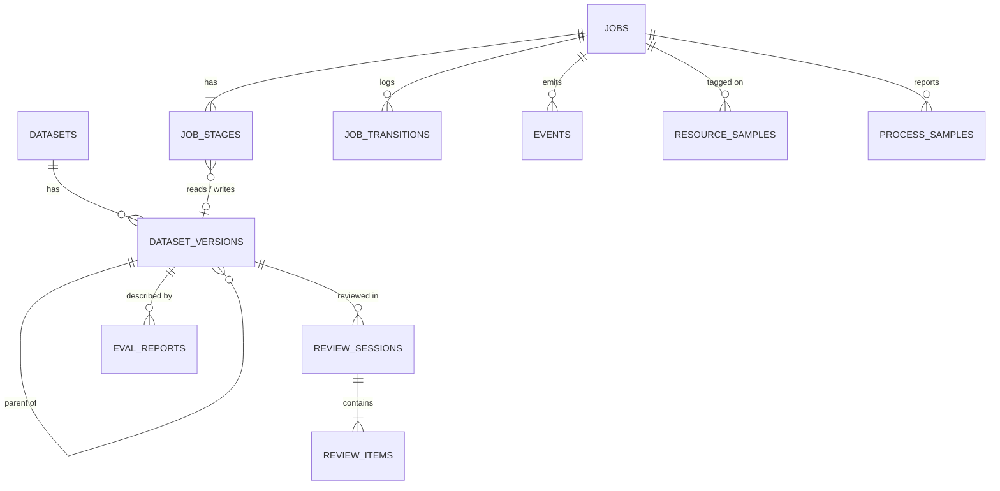

# Stratal — Data Model

| | |
|---|---|
| Status | §4.1–4.2 built in M1; §4.3–4.8 and the Redis keys built in M2 (2026-11-14). §4.9–4.11 are still planned |
| Detail level | Phase-1 tables are specified. Phase 2+ tables are outlined in [§9](#9-planned-for-later-phases) |
| Rule | Any schema change updates this file in the same change. Applied migrations are never edited |

## 1. Where data lives

| Store | Holds | Why this store |
|---|---|---|
| **PostgreSQL** | Jobs, stages, state transitions, events, telemetry, dataset versions and lineage, derivation cache, reviews, reports | Several processes write at once (API, workers, monitor); needs transactions and migrations |
| **Parquet manifests** | One file per dataset version: one row per item with status, hashes and per-stage columns | Columnar, compact, streamable in batches, queryable with DuckDB |
| **Blob store** | Image files (originals and preprocessed copies), named by content hash | Immutable, deduplicated by construction |
| **Redis** | Task queue, event stream buffer, live fan-out, control flags | Transient. Nothing in Redis is the only copy of anything that matters |
| **Per-job files** | Structured log, event spool, in-run checkpoints | Local durability that does not depend on any service being up |

## 2. Entity overview

## 3. Identifiers

| Entity | Format | Example | Generated by |
|---|---|---|---|
| Dataset | slug chosen by the user | `coco10k` | user, validated `[a-z0-9][a-z0-9_-]{1,62}` |
| Dataset version | `ds_` + 12 hex characters | `ds_7f3a9c21b04e` | derived from content hash and config hash (DATA-3.2) |
| Job | `job_` + zero-padded sequence | `job_0142` | Postgres sequence |
| Review session | `rev_` + zero-padded sequence | `rev_0007` | Postgres sequence |
| Blob | 64 hex characters (SHA-256 of the file's bytes) | `9f86d0…` | computed while copying |
| Event | UUID | – | the emitting process |

**Version ID contract (owner implements, DATA-3.2).** The function that derives a version ID must satisfy:

1. Same manifest content and same config always give the same ID, on any machine and any run.
2. Any change to a row, to the set of rows, or to the config gives a different ID.
3. Row order, Parquet writer version and file compression do not affect the ID. It is computed over logical content, not file bytes.
4. The full 64-hex digests are stored in `content_hash` and `config_hash`; the ID is a readable prefix.

The spec's examples show six hex characters. Six collide too easily (about a 3% chance among a thousand versions), so the ID uses twelve and the UI may show fewer (OC-4, resolved 2026-11-14).

**As implemented** (`stratal.data.versioning`):

- A row is encoded as its non-null columns in name order. Each name and value is length-prefixed, and each value carries a type tag, so `1`, `1.0`, `True` and `"1"` differ and a value cannot slide between columns or rows.
- Each encoded row is hashed with SHA-256. The digests are added modulo 2^256. `content_hash` is the SHA-256 of the row count and that sum.
- `config_hash` is the SHA-256 of the config as canonical JSON (sorted keys, no whitespace).
- `version_id` is `ds_` plus the first twelve hex characters of the SHA-256 of both hashes.
- A null and an absent column are the same, so a new empty column does not change existing IDs.
- A known-answer test pins the algorithm. Changing it changes every stored version ID, so that needs an ADR and a migration plan.

## 4. PostgreSQL schema (phase 1)

Types are PostgreSQL types. All timestamps are `timestamptz` in UTC.

### 4.1 `datasets`

| Column | Type | Null | Notes |
|---|---|---|---|
| `id` | bigint identity | no | PK |
| `slug` | text | no | unique |
| `display_name` | text | yes | |
| `modality` | text | no | `image`, `tabular`, `text` |
| `source_uri` | text | yes | where the raw data came from; informational |
| `created_at` | timestamptz | no | |

### 4.2 `dataset_versions`

| Column | Type | Null | Notes |
|---|---|---|---|
| `version_id` | text | no | PK, `ds_…` |
| `dataset_id` | bigint | no | FK → `datasets.id` |
| `stage` | text | no | `ingest`, `clean`, `preprocess`, `label`, `filter`, `split` |
| `parent_version_id` | text | yes | FK → `dataset_versions.version_id`; null only for `ingest` |
| `content_hash` | text | no | 64 hex |
| `config_hash` | text | no | 64 hex |
| `config` | jsonb | no | fully resolved stage config |
| `dtype` | text | yes | dataset type this version validates against, e.g. `image_caption` (DATA-5); null before it qualifies |
| `manifest_path` | text | no | relative to the data root |
| `manifest_bytes` | bigint | no | |
| `row_count` | integer | no | |
| `counts` | jsonb | no | rows by status and by reason |
| `new_blob_bytes` | bigint | no | bytes of files first written for this version (makes DATA-3.4.AC1 measurable) |
| `schema_version` | integer | no | manifest schema version |
| `code_version` | text | yes | git commit that produced it |
| `created_by_job_id` | text | yes | FK → `jobs.id` (since the M2 migration); null when created from the CLI |
| `created_at` | timestamptz | no | |

Indexes: `(dataset_id, created_at desc)`; `(stage, parent_version_id, config_hash)` for the memo lookup; `(parent_version_id)` for walking lineage downward.

### 4.3 `jobs`

| Column | Type | Null | Notes |
|---|---|---|---|
| `id` | text | no | PK, `job_…` |
| `kind` | text | no | `pipeline` in phase 1; later `train`, `hpo_study`, `hpo_trial`, `eval`, `maintenance` |
| `state` | text | no | `queued`, `running`, `paused`, `completed`, `failed`, `cancelled`, `stalled` (check constraint) |
| `desired_state` | text | yes | `paused` or `cancelled` while a request is pending |
| `spec` | jsonb | no | the fully resolved request |
| `dataset_id` | bigint | yes | FK |
| `input_version_id` | text | yes | FK |
| `output_version_id` | text | yes | FK; the final version produced |
| `attempt` | integer | no | incremented on every claim by a supervisor. Every later write by that supervisor is conditional on it, so a replaced supervisor cannot write over its successor |
| `current_stage_idx` | integer | yes | |
| `error` | jsonb | yes | `{code, reason, suggested_action, detail}` |
| `summary` | jsonb | yes | durations, throughput and peaks per stage (MON-2.5) |
| `worker` | text | yes | supervisor identity |
| `heartbeat_at` | timestamptz | yes | written by the supervisor every few seconds |
| `created_at`, `started_at`, `finished_at` | timestamptz | mixed | |

Indexes: `(state)`; `(created_at desc)`; partial `(heartbeat_at) where state = 'running'`. Job IDs come from the sequence `job_id_seq`.

### 4.4 `job_stages`

| Column | Type | Null | Notes |
|---|---|---|---|
| `job_id` | text | no | FK; PK part |
| `idx` | integer | no | PK part; order within the job |
| `name` | text | no | stage name |
| `queue` | text | no | `cpu` or `gpu` |
| `status` | text | no | `pending`, `queued`, `running`, `completed`, `failed`, `skipped`, `cancelled` |
| `config` | jsonb | no | |
| `config_hash` | text | no | |
| `input_version_id`, `output_version_id` | text | yes | FK |
| `cache_hit` | boolean | no | true when an existing version was reused |
| `step`, `total` | bigint | yes | latest progress |
| `throughput` | double precision | yes | moving average, items per second |
| `eta_seconds` | double precision | yes | MON-1.5 |
| `activity` | text | yes | latest plain-language message (MON-1.2) |
| `metrics` | jsonb | yes | latest stage metrics (MON-3) |
| `peaks` | jsonb | yes | peak VRAM, peak RAM, max temperature (MON-2.5) |
| `last_progress_at` | timestamptz | yes | used for stall detection |
| `started_at`, `finished_at` | timestamptz | yes | |
| `error` | jsonb | yes | |

### 4.5 `job_transitions`

| Column | Type | Null | Notes |
|---|---|---|---|
| `id` | bigint identity | no | PK |
| `job_id` | text | no | FK |
| `from_state` | text | yes | null for creation |
| `to_state` | text | no | |
| `reason` | text | yes | |
| `actor` | text | no | `api`, `supervisor`, `watchdog`, `user` |
| `at` | timestamptz | no | |

Index: `(job_id, at)`.

### 4.6 `events`

| Column | Type | Null | Notes |
|---|---|---|---|
| `id` | bigint identity | no | PK; insertion order; the SSE cursor |
| `event_uid` | uuid | no | unique; generated by the emitter so inserts are idempotent |
| `ts` | timestamptz | no | emitter's clock |
| `job_id` | text | yes | null for system events. Deliberately not a foreign key: an event must be storable whatever the state of its job row |
| `stage`, `substage` | text | yes | |
| `version_id` | text | yes | |
| `type` | text | no | `stage_started`, `stage_progress`, `stage_completed`, `stage_failed`, `activity`, `alert`, `action`, `model_loaded`, `model_unloaded`, `job_state`, `system` |
| `level` | text | no | `DEBUG`, `INFO`, `WARN`, `ERROR` |
| `step`, `total` | bigint | yes | |
| `message` | text | no | plain language |
| `metrics` | jsonb | yes | |
| `reason` | text | yes | required for WARN and ERROR (check constraint) |
| `suggested_action` | text | yes | required for WARN and ERROR (check constraint) |
| `attempt` | integer | yes | |

Indexes: `(job_id, id)`; partial `(id) where level in ('WARN','ERROR')`; BRIN on `ts`.

### 4.7 `resource_samples` (from the sampler)

| Column | Type | Notes |
|---|---|---|
| `id` | bigint identity | PK |
| `ts` | timestamptz | |
| `job_id`, `stage` | text, nullable | the primary active job and stage; the GPU job wins when two are active |
| `active_jobs` | jsonb, nullable | all active jobs at that moment |
| `interval_s` | real | the interval in force when sampled (MON-2.2.AC1) |
| `cpu_percent` | real | |
| `cpu_per_core` | real[] | |
| `ram_used_mb`, `ram_available_mb`, `ram_total_mb`, `swap_used_mb` | real | the WSL VM's view |
| `gpu_util_percent`, `gpu_mem_util_percent` | real, nullable | NVML |
| `vram_used_mb`, `vram_total_mb` | real, nullable | NVML (driver view) |
| `gpu_temp_c`, `gpu_power_w` | real, nullable | |
| `disk_read_mb_s`, `disk_write_mb_s` | real | |

Indexes: BRIN on `ts`; `(job_id, ts)`. GPU columns are nullable because a metric may be unavailable inside the container; the UI shows "unavailable", never zero.

### 4.8 `process_samples` (from the job itself)

| Column | Type | Notes |
|---|---|---|
| `id` | bigint identity | PK |
| `ts` | timestamptz | |
| `job_id` | text | not a foreign key, for the same reason as `events.job_id` |
| `stage` | text, nullable | |
| `rss_mb` | real | the job child and its children |
| `torch_allocated_mb`, `torch_reserved_mb`, `torch_max_allocated_mb` | real, nullable | null until the process has initialized CUDA |

Index: `(job_id, ts)`.

### 4.9 `derivations` (content-addressed cache)

| Column | Type | Notes |
|---|---|---|
| `kind` | text | PK part: `image_meta`, `phash`, `caption`, `clip_score` |
| `input_hash` | text | PK part: content hash of the input(s) |
| `params_hash` | text | PK part: hash of everything else that affects the result (model, revision, task, settings) |
| `value` | jsonb | the result |
| `created_by_job_id` | text, nullable | |
| `created_at` | timestamptz | |

### 4.10 `review_sessions` and `review_items` (LABEL-1.5)

`review_sessions`: `id` (PK, `rev_…`), `version_id` (FK, not null), `sample_size`, `seed`, `status` (`open`, `closed`), `created_at`, `closed_at`.

`review_items`: `session_id` (FK), `position` (integer; PK with `session_id`), `row_key` (text), `decision` (`accept`, `reject`, null until decided), `note`, `decided_at`.

### 4.11 `eval_reports` (EVAL-1.1)

`id` (bigint identity, PK), `version_id` (FK), `kind` (`phase1_dataset`), `report` (jsonb), `review_session_id` (FK, nullable), `job_id` (FK, nullable), `created_at`. Index: `(version_id, created_at desc)`.

## 5. Manifest schema

One Parquet file per version, at `manifests/<version_id>.parquet`. Columns accumulate as stages run; a column is null until its stage has run.

| Column | Type | Added by | Notes |
|---|---|---|---|
| `row_key` | string | ingest | unique per manifest. For image folders: the path relative to the source root |
| `sha256` | string | ingest | content hash of the original file; null only if the file could not be read |
| `size_bytes` | int64 | ingest | |
| `format` | string | ingest | e.g. `JPEG`, `PNG` |
| `width`, `height` | int32 | ingest | |
| `status` | string | ingest onward | `accepted`, `rejected`, `duplicate`, `filtered` |
| `decided_at_stage` | string | ingest onward | the stage that set a non-accepted status |
| `reason_code` | string | ingest onward | see below |
| `reason_detail` | string | ingest onward | free text, e.g. the decoder's error |
| `phash` | string | clean | perceptual hash, hex |
| `dup_kind` | string | clean | `exact`, `near`, `semantic` |
| `dup_group_id` | string | clean | shared by all members of a duplicate group, including the kept one |
| `dup_of` | string | clean | `row_key` of the kept item |
| `derived_sha256` | string | preprocess | content hash of the preprocessed copy |
| `derived_width`, `derived_height` | int32 | preprocess | |
| `caption` | string | label | |
| `caption_model`, `caption_model_revision` | string | label | LABEL-1.1.AC1 |
| `clip_score` | float32 | label | |
| `clip_model`, `clip_model_revision` | string | label | |
| `split` | string | split | defined by DATA-4 when the owner writes it |

Initial reason codes: `unreadable`, `corrupt_image`, `unsupported_format`, `below_min_size`, `exact_duplicate`, `near_duplicate`, `semantic_duplicate`, `missing_caption`, `missing_file`, `clip_below_threshold`.

File-level metadata keys: `stratal.schema_version`, `stratal.stage`, `stratal.parent_version_id`, `stratal.config_hash`. Rows are written sorted by `row_key`.

## 6. Blob store

- Path: `blobs/sha256/<first two hex>/<next two hex>/<full hash>`.
- A blob is written to `tmp/`, hashed while it is copied, flushed, then renamed into place. If the target already exists the temporary file is discarded.
- Blobs are read-only once written. Nothing modifies them. Only the garbage collector deletes them (phase 2, with dry-run), and only when no manifest of a live version refers to them.

## 7. Redis keys

| Key | Type | Purpose |
|---|---|---|
| `stratal:events` | stream | job child → collector. One consumer group, `collector`. Trimmed by approximate length. Each entry has `kind` (`event` or `process_sample`) and `data` (JSON) |
| `stratal:live:job:<job_id>` | pub/sub | → API, for SSE subscribers of one job. Messages are notifications: `{kind: "event" \| "job", job_id}` means "read PostgreSQL again"; `{kind: "sample", resource \| process}` carries the sample itself |
| `stratal:live:global` | pub/sub | job state changes, alerts and telemetry for global subscribers |
| `stratal:job:<job_id>:control` | string | `pause` or `cancel`. Fast path only; `jobs.desired_state` is the durable copy |
| `stratal:active` | hash | job ID → `{stage, queue, since}`. Read by the sampler to tag samples and pick the interval |
| Celery's own keys | – | queues `cpu` and `gpu` |

## 8. Invariants

Each of these is to be enforced by a constraint or covered by a test.

| ID | Invariant |
|---|---|
| INV-01 | A manifest file and its `dataset_versions` row are never modified after creation |
| INV-02 | A `dataset_versions` row exists only if its manifest file exists |
| INV-03 | Following `parent_version_id` from any version reaches an `ingest` version in a finite number of steps (DATA-3.3.AC1) |
| INV-04 | Every `sha256` and `derived_sha256` in a manifest with status `accepted` has a blob on disk |
| INV-05 | From the `clean` stage onward, `sha256` is unique among `accepted` rows |
| INV-06 | A manifest has exactly as many rows as its parent's manifest. Stages change status and add columns; they never drop rows |
| INV-07 | Every non-accepted row has `decided_at_stage` and `reason_code` |
| INV-08 | Job state changes only along the transitions in [ARCHITECTURE.md §4.2](ARCHITECTURE.md#42-job-states), and every change has a `job_transitions` row |
| INV-09 | At most one stage of a job is `running` at a time |
| INV-10 | Every WARN or ERROR event has a `reason` and a `suggested_action` |
| INV-11 | A derivation is never overwritten: the same `(kind, input_hash, params_hash)` always means the same value |
| INV-12 | At most one process holds the GPU lease |

## 9. Planned for later phases

Outlined only. Each is specified at its phase kickoff, with an ADR where it is architectural.

| Phase | Tables | Notes |
|---|---|---|
| 2 | `model_lineages`, `model_versions`, `checkpoints`, `pins`, `retention_settings` | Version state (`base`, `partial`, `trained`), weights status (`present`, `weights_deleted`), parent version, dataset version, config, metrics, size on disk. Retention deletions are logged as events (REG-2.9). Delete order per NFR-15 |
| 2 | Optuna's own tables, in a separate schema | Studies and trials (HPO) |
| 2 | `resource_samples_1m` or Parquet under `telemetry/1m/` | NFR-12 downsampling |
| 3 | `corpora`, `rag_indexes`, `chat_sessions`, `inference_requests` | Index versions for hit@k (LLM-2.2); request latency for NFR-6 |
| 4 | adapter columns on `model_versions` | LoRA deltas with a parent base (REG-1.3, REG-2.8) |

## 10. Retention and growth

| Data | Volume | Policy |
|---|---|---|
| `resource_samples`, `process_samples` | about 86,000 rows per day of continuous jobs each | Raw rows kept 7 days, then downsampled to 1-minute averages (NFR-12) |
| `events` | hundreds to a few thousand per job | Kept. Whether DEBUG events are pruned after 7 days is not specified in the input and will be proposed in M7 |
| Manifests | about 1–2 MB per 10k-row version | Kept; removed only with their version |
| Blobs | the dataset's size, once | Removed only by garbage collection |
| Per-job files | logs and spools | Kept; in-run checkpoints are deleted on success (REG-2.6) |
