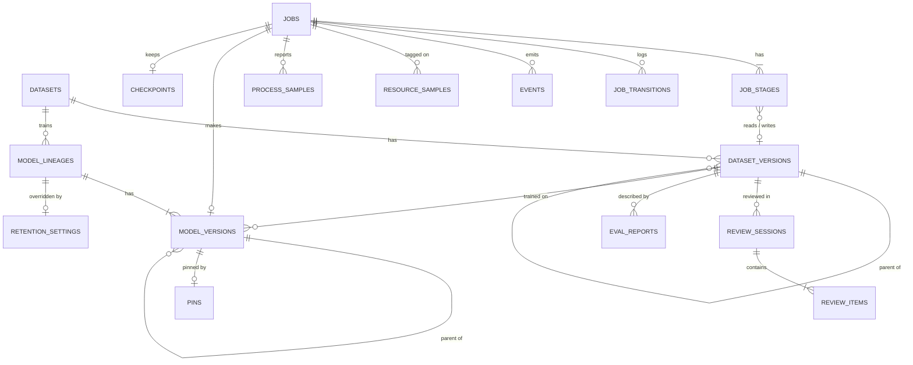

# Stratal — Data Model

| | |
|---|---|
| Status | §4.1–4.2 built in M1; §4.3–4.8 and the Redis keys built in M2 (2026-11-14); §4.9 built in M3 (2026-11-15); §4.10 and §4.11 built in M5 (2026-11-16); §4.12 and §4.13 built in M8 (2026-11-18, 2026-11-19) |
| Detail level | Phase-1 tables are specified. Phase 2+ tables are outlined in [§9](#9-planned-for-later-phases) |
| Rule | Any schema change updates this file in the same change. Applied migrations are never edited |

## 1. Where data lives

| Store | Holds | Why this store |
|---|---|---|
| **PostgreSQL** | Jobs, stages, state transitions, events, telemetry, dataset versions and lineage, derivation cache, reviews, reports; since M8 the model registry and the settings edited on SCR-14 | Several processes write at once (API, workers, monitor); needs transactions and migrations |
| **Parquet manifests** | One file per dataset version: one row per item with status, hashes and per-stage columns | Columnar, compact, streamable in batches, queryable with DuckDB |
| **Blob store** | Image files (originals and preprocessed copies), named by content hash | Immutable, deduplicated by construction |
| **Redis** | Task queue, event stream buffer, live fan-out, control flags | Transient. Nothing in Redis is the only copy of anything that matters |
| **Per-job files** | Structured log, event spool, in-run checkpoints | Local durability that does not depend on any service being up |
| **Registry files** | Model weights as safetensors with `model.json` beside them, one folder per version (`registry/<lineage>/<version>/`, M8); a classical model as `model.skops` with `model.json` (M10, ML-1.5); a table network adds `preprocess.json`, its fitted encoding (M10, ADR-0019 rule 13). Nothing here or in a checkpoint is pickled; a network file that is not safetensors, or a skops file holding a type outside Stratal's allow-list, is refused with `weights_unreadable` (NFR-8) | Deletable by retention, so not content-addressed (ADR-0015) |

## 2. Entity overview

## 3. Identifiers

| Entity | Format | Example | Generated by |
|---|---|---|---|
| Dataset | slug chosen by the user | `coco10k` | user, validated `[a-z0-9][a-z0-9_-]{1,62}` |
| Dataset version | `ds_` + 12 hex characters | `ds_7f3a9c21b04e` | derived from content hash and config hash (DATA-3.2) |
| Job | `job_` + zero-padded sequence | `job_0142` | Postgres sequence |
| Review session | `rev_` + zero-padded sequence | `rev_0007` | Postgres sequence |
| Model lineage | `ml_` + 12 hex characters | `ml_319245b543d4` | SHA-256 of the lineage key (model spec, dataset slug, input shape, classes) as canonical JSON (M8) |
| Model version | `mv_` + 12 hex characters | `mv_23763657482f` | random (`secrets.token_hex(6)`); weights are not content-addressed (ADR-0015) |
| Blob | 64 hex characters (SHA-256 of the file's bytes) | `9f86d0…` | computed while copying |
| Event | UUID | – | the emitting process |

**Version ID contract (owner implements, DATA-3.2).** The function that derives a version ID must satisfy:

1. Same manifest content and same config always give the same ID, on any machine and any run.
2. Any change to a row, to the set of rows, or to the config gives a different ID.
3. Row order, Parquet writer version and file compression do not affect the ID. It is computed over logical content, not file bytes.
4. The full 64-hex digests are stored in `content_hash` and `config_hash`; the ID is a readable prefix.

The spec's examples show six hex characters. Six collide too easily (about a 3% chance among a thousand versions), so the ID uses twelve and the UI may show fewer (OC-4, resolved 2026-11-14).

**As implemented** (`stratal.data.versioning`):

- A row is encoded as its non-null columns in name order. Each name and value is length-prefixed, and each value carries a type tag, so `1`, `1.0`, `True` and `"1"` differ and a value cannot slide between columns or rows.
- Each encoded row is hashed with SHA-256. The digests are added modulo 2^256. `content_hash` is the SHA-256 of the row count and that sum.
- `config_hash` is the SHA-256 of the config as canonical JSON (sorted keys, no whitespace).
- `version_id` is `ds_` plus the first twelve hex characters of the SHA-256 of both hashes.
- A null and an absent column are the same, so a new empty column does not change existing IDs.
- A known-answer test pins the algorithm. Changing it changes every stored version ID, so that needs an ADR and a migration plan.

## 4. PostgreSQL schema

Types are PostgreSQL types. All timestamps are `timestamptz` in UTC.

### 4.1 `datasets`

| Column | Type | Null | Notes |
|---|---|---|---|
| `id` | bigint identity | no | PK |
| `slug` | text | no | unique |
| `display_name` | text | yes | |
| `modality` | text | no | `image`, `tabular`, `text` |
| `source_uri` | text | yes | where the raw data came from; informational |
| `created_at` | timestamptz | no | |

### 4.2 `dataset_versions`

| Column | Type | Null | Notes |
|---|---|---|---|
| `version_id` | text | no | PK, `ds_…` |
| `dataset_id` | bigint | no | FK → `datasets.id` |
| `stage` | text | no | `ingest`, `clean`, `preprocess`, `label`, `filter`, `split` |
| `parent_version_id` | text | yes | FK → `dataset_versions.version_id`; null only for `ingest` |
| `content_hash` | text | no | 64 hex |
| `config_hash` | text | no | 64 hex |
| `config` | jsonb | no | fully resolved stage config |
| `dtype` | text | yes | dataset type this version validates against, `image_caption` or `labelled_images` (DATA-5); null before it qualifies. Set to `image_caption` by the filter stage, which validates the schema (DATA-5.1, since M5); set to `labelled_images` by ingest with `label_from: folder` (DATA-5.2, since M8). A stage that keeps the rows (clean, preprocess, split) keeps its parent's type |
| `manifest_path` | text | no | relative to the data root |
| `manifest_bytes` | bigint | no | |
| `row_count` | integer | no | |
| `counts` | jsonb | no | rows by status and by reason; a `filter` version adds `validation` (DATA-5.1: `dtype`, `checked`, `valid`, `by_reason`, `rejected_rows`); a `split` version adds `split`, its split report (DATA-4.6): rows per split and per stratum with targets and a within-one-group flag, group count and sizes, rows carried over, newly assigned and moved (with the moved rows listed), and the leakage check |
| `new_blob_bytes` | bigint | no | bytes of files first written for this version (makes DATA-3.4.AC1 measurable) |
| `schema_version` | integer | no | manifest schema version |
| `code_version` | text | yes | git commit that produced it |
| `created_by_job_id` | text | yes | FK → `jobs.id` (since the M2 migration); null when created from the CLI |
| `created_at` | timestamptz | no | |

Indexes: `(dataset_id, created_at desc)`; `(stage, parent_version_id, config_hash)` for the memo lookup; `(parent_version_id)` for walking lineage downward.

### 4.3 `jobs`

| Column | Type | Null | Notes |
|---|---|---|---|
| `id` | text | no | PK, `job_…` |
| `kind` | text | no | `pipeline`; since M8 also `train` (RUN-1.1) and `retention` (REG-2.2); since M10 `hpo_study` and `hpo_trial` (HPO-1.2); later `eval`, `maintenance` |
| `state` | text | no | `queued`, `running`, `paused`, `completed`, `failed`, `cancelled`, `stalled` (check constraint) |
| `desired_state` | text | yes | `paused` or `cancelled` while a request is pending |
| `pause_reason` | text | yes | why a paused job is paused: `user` or `thermal` (M8, RUN-1.6); set with the pause request, kept while paused, cleared on resume. The watchdog resumes only `thermal` pauses |
| `spec` | jsonb | no | the fully resolved request |
| `dataset_id` | bigint | yes | FK |
| `input_version_id` | text | yes | FK |
| `output_version_id` | text | yes | FK; the final version produced |
| `attempt` | integer | no | incremented on every claim by a supervisor. Every later write by that supervisor is conditional on it, so a replaced supervisor cannot write over its successor |
| `current_stage_idx` | integer | yes | |
| `error` | jsonb | yes | `{code, reason, suggested_action, detail}` |
| `summary` | jsonb | yes | durations, throughput and peaks per stage (MON-2.5) |
| `worker` | text | yes | supervisor identity |
| `heartbeat_at` | timestamptz | yes | written by the supervisor every few seconds |
| `created_at`, `started_at`, `finished_at` | timestamptz | mixed | |

Indexes: `(state)`; `(created_at desc)`; partial `(heartbeat_at) where state = 'running'`. Job IDs come from the sequence `job_id_seq`.

### 4.4 `job_stages`

| Column | Type | Null | Notes |
|---|---|---|---|
| `job_id` | text | no | FK; PK part |
| `idx` | integer | no | PK part; order within the job |
| `name` | text | no | stage name |
| `queue` | text | no | `cpu` or `gpu` |
| `status` | text | no | `pending`, `queued`, `running`, `paused` (M8, RUN-1.2: stopped by a pause, or next to run when the job paused between stages), `waiting` (M10, ADR-0018 rule 5: a network study's `study` stage between steps, while its trial job runs), `completed`, `failed`, `skipped`, `cancelled` |
| `config` | jsonb | no | |
| `config_hash` | text | no | |
| `input_version_id`, `output_version_id` | text | yes | FK |
| `cache_hit` | boolean | no | true when an existing version was reused |
| `step`, `total` | bigint | yes | latest progress |
| `throughput` | double precision | yes | moving average, items per second |
| `eta_seconds` | double precision | yes | MON-1.5 |
| `activity` | text | yes | latest plain-language message (MON-1.2) |
| `metrics` | jsonb | yes | latest stage metrics (MON-3) |
| `peaks` | jsonb | yes | peak VRAM, peak RAM, max temperature (MON-2.5) |
| `last_progress_at` | timestamptz | yes | the last progress report or activity message from the stage (activity counts since M8, ADR-0014 rule 7); the watchdog's stall detection (RUN-1.7) compares it with `stall_timeout_s` |
| `started_at`, `finished_at` | timestamptz | yes | |
| `error` | jsonb | yes | |

### 4.5 `job_transitions`

| Column | Type | Null | Notes |
|---|---|---|---|
| `id` | bigint identity | no | PK |
| `job_id` | text | no | FK |
| `from_state` | text | yes | null for creation |
| `to_state` | text | no | |
| `reason` | text | yes | |
| `actor` | text | no | `api`, `supervisor`, `watchdog`, `user` |
| `at` | timestamptz | no | |

Index: `(job_id, at)`.

### 4.6 `events`

| Column | Type | Null | Notes |
|---|---|---|---|
| `id` | bigint identity | no | PK; insertion order; the SSE cursor |
| `event_uid` | uuid | no | unique; generated by the emitter so inserts are idempotent |
| `ts` | timestamptz | no | emitter's clock |
| `job_id` | text | yes | null for system events. Deliberately not a foreign key: an event must be storable whatever the state of its job row |
| `stage`, `substage` | text | yes | |
| `version_id` | text | yes | |
| `type` | text | no | `stage_started`, `stage_progress`, `stage_completed`, `stage_failed`, `activity`, `alert`, `action`, `model_loaded`, `model_unloaded`, `job_state`, `system`, `diagnostic` (M11) |
| `level` | text | no | `DEBUG`, `INFO`, `WARN`, `ERROR` |
| `step`, `total` | bigint | yes | |
| `message` | text | no | plain language |
| `metrics` | jsonb | yes | |
| `reason` | text | yes | required for WARN and ERROR (check constraint) |
| `suggested_action` | text | yes | required for WARN and ERROR (check constraint) |
| `attempt` | integer | yes | |
| `caused_by` | uuid | yes | M11 (MON-2.7, [ADR-0020](decisions/ADR-0020-alerts-and-diagnostics.md) rule 4): the `event_uid` of the alert that caused this event: an action (pause, resume, `stalled`), a linked out-of-memory failure, or a clearing. Not a foreign key: the writer knows the alert's uid before its row exists |

Indexes: `(job_id, id)`; partial `(id) where level in ('WARN','ERROR')`; BRIN on `ts`; partial `(caused_by) where caused_by is not null` (M11).

**Alerts and diagnostics (M11, ADR-0020).** An alert is an `alert` event: a firing is WARN with `metrics` `{code, state: "fired", value, threshold, rearm_below}` (`code` is `vram_high`, `ram_high`, `gpu_hot` or `no_progress`); its clearing is INFO with `{code, state: "cleared", value}` and `caused_by`. A diagnosis is a `diagnostic` event, WARN with `{code, state: "fired", gpu_percent, cpu_cores, capacity_cores, loader_workers, disk_read_mb_s, samples}` (`code` is `diag_data_loading`, `diag_disk` or `diag_gpu_waiting`), cleared by an INFO one with `caused_by`. Model loads and unloads are `model_loaded` and `model_unloaded` events with `allocated_mb_*`, `reserved_mb_*`, `free_mb_*` and `card_used_mb_*` before and after (MON-3.3).

### 4.7 `resource_samples` (from the sampler)

| Column | Type | Notes |
|---|---|---|
| `id` | bigint identity | PK |
| `ts` | timestamptz | |
| `job_id`, `stage` | text, nullable | the primary active job and stage; the GPU job wins when two are active |
| `active_jobs` | jsonb, nullable | all active jobs at that moment |
| `interval_s` | real | the interval in force when sampled (MON-2.2.AC1) |
| `cpu_percent` | real | |
| `cpu_per_core` | real[] | |
| `ram_used_mb`, `ram_available_mb`, `ram_total_mb`, `swap_used_mb` | real | the WSL VM's view |
| `gpu_util_percent`, `gpu_mem_util_percent` | real, nullable | NVML |
| `vram_used_mb`, `vram_total_mb` | real, nullable | NVML (driver view) |
| `gpu_temp_c`, `gpu_power_w` | real, nullable | |
| `disk_read_mb_s`, `disk_write_mb_s` | real | |

Indexes: BRIN on `ts`; `(job_id, ts)`. GPU columns are nullable because a metric may be unavailable inside the container; the UI shows "unavailable", never zero.

### 4.8 `process_samples` (from the job itself)

| Column | Type | Notes |
|---|---|---|
| `id` | bigint identity | PK |
| `ts` | timestamptz | |
| `job_id` | text | not a foreign key, for the same reason as `events.job_id` |
| `stage` | text, nullable | |
| `rss_mb` | real | the job child and its children |
| `torch_allocated_mb`, `torch_reserved_mb`, `torch_max_allocated_mb` | real, nullable | null until the process has initialized CUDA |
| `cpu_cores` | real, nullable | M11 (MON-3.2, OC-12): CPU time of the job child and all its children per wall second since the previous sample, in cores; null in the first sample |

Index: `(job_id, ts)`.

### 4.8a `resource_samples_1m`, `process_samples_1m` (NFR-12, added in M7)

One-minute averages of the two sample tables, for samples older than the raw retention (`telemetry_keep_days`, 7). The `beat` service moves whole minutes hourly: in one transaction per six hours of raw data it inserts the averages and deletes the raw rows they replace, so a minute is never counted twice or half moved.

| Column | Notes |
|---|---|
| `id`, `ts` | `ts` is the start of the minute |
| `job_id`, `stage` | as in the raw table; one row per minute, job and stage |
| `samples` | how many raw rows the row averages |
| the raw table's numeric columns | averages; nullable ones stay null when every sample was null. `process_samples_1m.torch_max_allocated_mb` is the maximum; `cpu_cores` (M11) is averaged |

Not kept: `cpu_per_core` and `active_jobs`. `GET /jobs/{id}/telemetry` returns the averages alongside raw rows, with `cpu_per_core` empty and `active_jobs` null. Indexes: `resource_samples_1m` BRIN on `ts` and `(job_id, ts)`; `process_samples_1m` `(job_id, ts)`.

### 4.9 `derivations` (content-addressed cache)

| Column | Type | Notes |
|---|---|---|
| `kind` | text | PK part: `phash` and `preprocess` (built in M3), `caption` and `clip_score` (M4); `image_meta` planned |
| `input_hash` | text | PK part: content hash of the input(s) |
| `params_hash` | text | PK part: hash of everything else that affects the result (model, revision, task, settings) |
| `value` | jsonb | the result |
| `created_by_job_id` | text, nullable | not a foreign key: a cached value outlives its job |
| `created_at` | timestamptz | |

Values as built in M3 (`params_hash` is SHA-256 of the canonical JSON of the parameters):

| Kind | `input_hash` | Parameters hashed | `value` |
|---|---|---|---|
| `phash` | original file's `sha256` | `hash_size`, `algorithm_version` and the Pillow version | the hash, lowercase hex text |
| `preprocess` | original file's `sha256` | the whole `PreprocessConfig` and the Pillow version | `{"sha256", "width", "height"}` of the copy; reused only if that blob still exists (INV-04) |
| `clip_image_embedding` (M11) | preprocessed copy's `sha256` | CLIP model and revision, dtype, torch, transformers and Pillow versions | the image's CLIP vector, float16 base64 (about 1 KB), for the semantic clusters (ADR-0013 rule 2) |
| `caption` | preprocessed copy's `sha256` | captioner name and revision, task, `max_new_tokens`, `num_beams`, dtype, the caption loop's `ALGORITHM_VERSION`, torch, transformers and Pillow versions | the caption text |
| `clip_score` | SHA-256 of the copy's `sha256`, a newline and the caption | CLIP model and revision, dtype, the similarity's `ALGORITHM_VERSION`, library versions | the score, a number |

### 4.10 `review_sessions` and `review_items` (LABEL-1.5)

`review_sessions`: `id` (text PK, `rev_` plus the sequence `review_id_seq`, zero-padded), `version_id` (FK → `dataset_versions`, not null), `sample_size` (integer > 0), `seed` (bigint; drawn by the server and recorded when the request gives none), `status` (`open`, `closed`), `created_at`, `closed_at`. Index `(version_id, created_at)`.

`review_items`: `session_id` (FK, cascades on delete), `position` (integer > 0, the order of the sample; PK with `session_id`), `row_key` (text; unique within a session), `split` (the row's split when it was sampled, null for an unsplit version; DATA-4.7, added in M5), `decision` (`accept`, `reject`, null until decided), `note`, `decided_at`. Decisions change no manifest, split or status (DATA-4.7).

### 4.11 `eval_reports` (EVAL-1.1)

`id` (bigint identity, PK), `version_id` (FK), `kind` (`phase1_dataset`), `report` (jsonb), `review_session_id` (FK, nullable), `job_id` (FK, nullable), `created_at`. Index: `(version_id, created_at desc)`. Built in M5 (2026-11-16). The `report` document is described in [API.md §3.6](API.md#36-evaluation-eval-11).

### 4.12 Model registry (M8, REG-1.1, REG-1.2, [ADR-0015](decisions/ADR-0015-model-registry-and-retention.md))

**`model_lineages`**: one model on one task (ADR-0015 rule 1).

| Column | Type | Null | Notes |
|---|---|---|---|
| `id` | text | no | PK, `ml_…`, derived from the key |
| `key_hash` | text | no | unique; the full SHA-256 of the key: model spec, dataset slug, input shape and class list. Any difference is another lineage, since weights for one shape or class list cannot start a run for another |
| `name` | text | no | `<model> · <dataset>`, e.g. `small_cnn · cifar10` |
| `task` | text | no | `classification` in M8 |
| `model_spec` | jsonb | no | the train config's `model` |
| `dataset_id` | bigint | no | FK |
| `input_shape` | jsonb | no | `[C, H, W]` |
| `classes` | jsonb | no | class names in label order |
| `parameters` | bigint | no | |
| `created_at` | timestamptz | no | |

**`model_versions`**: a lineage's base, or one training run's result.

| Column | Type | Null | Notes |
|---|---|---|---|
| `id` | text | no | PK, `mv_…` |
| `lineage_id` | text | no | FK |
| `state` | text | no | `base`, `partial` (its run is paused), `trained` (REG-1.2) |
| `weights_status` | text | no | `present`, `deleting`, `weights_deleted` (NFR-15, REG-2.7) |
| `parent_version_id` | text | yes | FK → `model_versions`; the version the run started from: its lineage's base, or since M11 the trained version in `config.init_from` (RUN-1.10), which may be in another lineage. Null for a base, and for runs registered by the backfill that did not start from it. Retention keeps a version while a version naming it as parent has weights, or a queued or running fine-tune or study starts from it (ADR-0015 Addendum A) |
| `job_id` | text | yes | FK; the run that made it. A base records the run that created the lineage, so uniqueness is per run: partial unique index on `job_id` where `state <> 'base'` |
| `dataset_version_id` | text | yes | FK; the exact data (REG-1.1) |
| `config`, `config_hash` | jsonb, text | no | the run's resolved train config and its SHA-256 over canonical JSON (REG-1.1) |
| `metrics` | jsonb | yes | the stage's final metrics; null while partial |
| `history` | jsonb | yes | one entry per finished epoch; a fine-tune's starts with epoch 0, its validation before step 1 (RUN-1.10.AC1) |
| `weights_path` | text | yes | `registry/<lineage>/<version>`, relative to the data folder; null while partial (its weights are the run's checkpoint) |
| `weights_bytes` | bigint | yes | both files |
| `note` | text | yes | how it came to be, where that is unusual (a base's seed; a lineage founded by a fine-tune, whose base is the run's starting weights; a backfilled run without a parent) |
| `created_at`, `trained_at`, `weights_deleted_at` | timestamptz | mixed | a base has no `trained_at` |
| `weights_deleted_by_job_id` | text | yes | FK → `jobs`; the retention job that deleted the weights (REG-2.9; added with retention, migration `19c70056c3ce`) |

Constraints: state and weights status check constraints; `present` needs a path and size unless `partial`; one base per lineage (partial unique index on `lineage_id` where `state = 'base'`). Indexes `(lineage_id, created_at)`, `(parent_version_id)`.

**`checkpoints`**: a run's in-run checkpoint, the latest only (REG-2.6). `job_id` (PK, FK), `lineage_id` (FK; null for an HPO trial's, which belongs to its study, M10), `path` (the checkpoint's JSON file, relative to the data folder), `bytes` (both files), `global_step`, `epoch`, `updated_at`. Written at every save, removed when the run completes; retention removes those of cancelled runs. A failed run keeps its checkpoint, since a retry resumes from it.

**`pins`**: `version_id` (PK, FK), `pinned_at`. Only trained versions with weights on disk are pinned (REG-2.5).

**`retention_settings`**: `id` (identity), `lineage_id` (FK, null for the global row; unique with nulls not distinct, so one global row), `keep_intermediate` (integer ≥ 0, null for "all"), `updated_at`. The migration inserts the global row with 0 (REG-2.3's default). Saved through `PUT /settings` (API.md §3.10).

### 4.13 `settings` (M8, OC-9, SCR-14)

`section` (text, PK), `values` (jsonb), `updated_at`. One row per section of SCR-14 other than retention, which has its own table above. In M8 the only row is `training`: `{checkpoint_interval_min, thermal_pause_c, thermal_resume_c, stall_timeout_s}` (`stratal.runtime.limits.TrainingValues`). Until it is saved the environment's `STRATAL_THERMAL_PAUSE_C`, `STRATAL_THERMAL_RESUME_C` and `STRATAL_STALL_TIMEOUT_S` are the values, so a fresh install behaves as before. The watchdog reads it before every check; `checkpoint_interval_min` becomes `checkpoint_every_s` of new training runs that do not set it. M11 adds `monitoring`: `{sample_interval_active_s, sample_interval_idle_s, vram_alert_percent, ram_alert_percent, disk_bottleneck_mb_s}` (`stratal.runtime.limits.MonitoringValues`; MON-2.2, MON-2.6, MON-3.2; ADR-0020 rule 14), the environment's values until saved; the alerts read it at most every 5 s, the sampler every 30 s.

### 4.14 `model_templates` (M9, BUILD-1.7, [ADR-0017](decisions/ADR-0017-model-spec.md) rule 9)

`id` (text PK, `mt_` + 12 hex), `name` (text, unique), `description` (text), `spec` (jsonb: a graph spec in canonical form), `structure_hash` (text: SHA-256 of the canonical structure without its label), `dataset_type` (text), `builtin` (bool), `created_at`, `updated_at`. Built-in templates are written by `stratal.build.store.ensure_builtins` on the first list and refreshed when the code's spec changes; they cannot be changed or deleted through the API.

A graph spec is also stored, as part of its run's config, in `job_stages.config`, `model_versions.config` and `model_lineages.model_spec`; the lineage's copy has no `label` (ADR-0017 rule 1).

### 4.15 HPO studies (M10, HPO-1.1 to HPO-1.5, [ADR-0018](decisions/ADR-0018-hpo-execution.md))

`studies`: `id` (`st_` + 12 hex), `job_id` (unique, FK), `kind` (`classical`, `deep`), `dataset_version_id`, `base` (jsonb: the base run, defaults filled in), `space` (jsonb: the markers), `objective`, `direction` (`maximize`, `minimize`), `limits` (jsonb `{n_trials, timeout_s}`), `pruning`, `cv_folds`, `seed`, `state` (`running`, `closed`, `completed`, `cancelled`, `failed`), `ended_by` (`n_trials`, `timeout`), `elapsed_s` (running time, pauses excluded), `best_trial`, `best_value`, `best_params` (jsonb, by path), `importance` (jsonb), `best_version_id` (FK `model_versions`), `test_metrics` (jsonb), `test_evaluated_at` (set once, HPO-1.4), `created_at`, `finished_at`.

`study_trials`: `study_id`, `number` (the PK together), `job_id` (a deep-learning trial's job, else null), `state` (`running`, `complete`, `pruned`, `failed`), `params` (jsonb), `value`, `step`, `prune_reason` (`median`, `budget`), `code` (`invalid_combination`, `interrupted`, …), `intermediate` (jsonb `[[step, value]]`), `duration_s`, `started_at`, `finished_at`.

A network trial's weights live in its job's folder until its study's next step: `jobs/<job>/trial/initial` (when its lineage is new), `trial/trained` and `trial/result.json`. Only the best trial's are kept, and they are deleted once copied into the registry (ADR-0018 rule 7).

`model_versions.study_id` (FK, null) names the study whose best trial a version is. Optuna's own tables live in schema `optuna`, created empty by the migration and filled by Optuna; the API never reads them.

## 5. Manifest schema

One Parquet file per version, at `manifests/<version_id>.parquet`. Columns accumulate as stages run; a column is null until its stage has run.

| Column | Type | Added by | Notes |
|---|---|---|---|
| `row_key` | string | ingest | unique per manifest. For image folders: the path relative to the source root |
| `sha256` | string | ingest | content hash of the original file; null only if the file could not be read |
| `size_bytes` | int64 | ingest | |
| `format` | string | ingest | e.g. `JPEG`, `PNG` |
| `width`, `height` | int32 | ingest | |
| `status` | string | ingest onward | `accepted`, `rejected`, `duplicate`, `filtered` |
| `decided_at_stage` | string | ingest onward | the stage that set a non-accepted status |
| `reason_code` | string | ingest onward | see below |
| `reason_detail` | string | ingest onward | free text, e.g. the decoder's error |
| `phash` | string | clean | perceptual hash as lowercase hex, `hash_size²` bits (16 hex digits at the default 8); set on every row that was accepted when clean started (exact copies share their keeper's) |
| `dup_kind` | string | clean | `exact`, `near`, `semantic`; set on every member of a group, the kept one included |
| `dup_group_id` | string | clean | shared by all members of a duplicate group, including the kept one: `dg_` + the first 12 hex of SHA-256 over the kind and the sorted member keys. A kept exact copy that also falls in a near group carries the near group's ID |
| `dup_of` | string | clean | `row_key` of the kept item; null on the kept item |
| `derived_sha256` | string | preprocess | content hash of the preprocessed copy (DATA-6.1): RGB JPEG, upright, longer side ≤ `max_side` |
| `derived_width`, `derived_height` | int32 | preprocess | size of the copy, after EXIF rotation |
| `caption` | string | label | |
| `caption_model`, `caption_model_revision` | string | label | LABEL-1.1.AC1 |
| `clip_score` | float32 | label | |
| `clip_model`, `clip_model_revision` | string | label | |
| `label` | string | ingest | the class label of a labelled-images row (DATA-5.2): with `label_from: folder`, the first folder of `row_key`, e.g. `airplane`; null in every other dataset type. Added in M8 as a nullable column, so no existing version ID changed (DATA-3.2: a null value and an absent column hash the same) |
| `split` | string | split | `train`, `val` or `test` on every accepted row, null on all others (DATA-4.1). Built in M5 |
| `split_group` | string | split | content hash (`sha256`) of the split group's anchor, its member with the smallest `sha256`; rows sharing a duplicate group or within the leakage distance share it (DATA-4.2). Built in M5 |
| `split_stratum` | string | split | the row's stratum, its keys joined by `\|`, e.g. `q3\|landscape\|train2017`, or `q3\|landscape\|.` for a file at the source's root, as in the flat COCO sources (DATA-4.3; `.` chosen by the owner 2026-11-16). Built in M5 |

Initial reason codes: `unreadable`, `corrupt_image`, `unsupported_format`, `below_min_size`, `exact_duplicate`, `near_duplicate`, `semantic_duplicate`, `missing_caption`, `missing_file`, `clip_below_threshold`. M8 adds `no_label` (ingest with `label_from: folder`, for a file at the source's root) and `missing_label` (the labelled-images validator). M10 adds `conflicting_labels` (a labels CSV gives an image two classes, DATA-1.5); `missing_target`, `missing_column`, `not_a_number` and `not_a_category` (a table record that breaks its schema, DATA-1.4); `missing_label` also for a text without a class; `empty_text` and `text_too_long` (`clean_text`, DATA-2.4). M11b adds `cast_failed` (a value that will not convert to the kind a transform sets, DATA-7.2; the row is kept with its value) and `transform_filter` (a row a transform's filter drops, status `filtered`, DATA-7.4); the `transform` stage may also reject with `missing_target` (its new target is empty) and take back a row ingest rejected only as `missing_target` (ADR-0019 Addendum B rule 27).

**Tables and texts (M10, [ADR-0019](decisions/ADR-0019-tabular-and-text-models.md))** have one row per record, not per file:

| Column | Type | Added by | Notes |
|---|---|---|---|
| `row_key` | | ingest | `<file>#<record or line number, 7 digits>`, e.g. `breast_cancer.csv#0000001`, `captions.jsonl#0000042` |
| `sha256` | | ingest, `clean_text` | the hash of the row's content: the canonical `record`, or the text (after `clean_text`, the normalised text), so exact duplicates are found as for files |
| `format` | | ingest | `CSV`, `PARQUET`, `JSONL` or `TXT` |
| `record` | string | ingest | a table row's feature values as canonical JSON (keys sorted, numbers as floats, categories as strings, a missing value as null) |
| `target_value` | float64 | ingest | a numeric target (regression); a categorical target is in `label` |
| `text` | string | ingest, `clean_text` | the text; `clean_text` writes it back normalised |
| `text_group` | string | ingest | rows that must share a split (the captions of one image); null: the row is its own group |
| `tokens` | string | tokenize | L token IDs as space-separated numbers (0 padding, 1 unknown); a string, because the version hash takes scalar values only (DATA-3.2) |
| `token_count` | int32 | tokenize | the text's length in tokens before it was cut to L |
| `semantic_cluster_id` | string | label | M11 (DATA-2.3, [ADR-0013](decisions/ADR-0013-semantic-duplicates.md)): the smallest original `sha256` of the semantic cluster an accepted row is in; null for a row in none. Rows with one ID join one split group (DATA-4.8). With `semantic_action: remove`, all but the cluster's first member are `duplicate` with `reason_code` `semantic_duplicate`, `dup_kind` `semantic`, `dup_group_id` the cluster ID and `dup_of` the kept row. Appended and nullable, so no earlier version ID changes; reading an older manifest gives null |

All six are nullable and appended, so no earlier version's ID changed.

`corrupt_image` is normally decided at ingest. Clean and preprocess decode the image again and use the same code, with their own stage in `decided_at_stage`, if that decode fails. In clean and preprocess, a file missing from the blob store is not a reason code: it fails the stage (BUG1). The filter stage is the exception: its schema validation (DATA-5.1) marks a row whose original or preprocessed file is missing `rejected` with `missing_file`, warns, and lists it in `counts.validation` (the owner's choice, 2026-11-16).

File-level metadata keys: `stratal.schema_version`, `stratal.stage`, `stratal.parent_version_id`, `stratal.config_hash`. Since M10 also `stratal.table_schema` (a table's columns with kind and role, and its task: `classification` or `regression`), passed on by every stage that keeps the rows, and `stratal.vocab` (`{sha256, size, max_length}` of a tokenized version's vocabulary, a JSON blob). They follow from the rows and the config, so they are not part of the identity. *Since M11b (ADR-0019 Addendum B, as built; the owner's choice, 2026-11-25):* a transform can change a table's schema without changing its rows (an encoding, the column order), so `clean_table` and `split` record their input's schema hash (SHA-256 of the `stratal.table_schema` JSON) in their config as `input_schema`, a read-only field the stage fills in; through the config it is part of their versions' identity. A schema's columns may carry `encoding` and `order` (DATA-7.3), written only when set. The vocabulary blob is referenced only from this metadata: the blob garbage collector (phase 2) must count it as in use. Rows are written sorted by `row_key`.

## 6. Blob store

- Path: `blobs/sha256/<first two hex>/<next two hex>/<full hash>`.
- A blob is written to `tmp/`, hashed while it is copied, flushed, then renamed into place. If the target already exists the temporary file is discarded.
- Blobs are read-only once written. Nothing modifies them. Only the garbage collector deletes them (phase 2, with dry-run), and only when no manifest of a live version refers to them.

## 7. Redis keys

| Key | Type | Purpose |
|---|---|---|
| `stratal:events` | stream | job child → collector. One consumer group, `collector`. Trimmed by approximate length. Each entry has `kind` (`event` or `process_sample`) and `data` (JSON) |
| `stratal:live:job:<job_id>` | pub/sub | → API, for SSE subscribers of one job. Messages are notifications: `{kind: "event" \| "job", job_id}` means "read PostgreSQL again"; `{kind: "sample", resource \| process}` carries the sample itself |
| `stratal:live:global` | pub/sub | job state changes, alerts and telemetry for global subscribers |
| `stratal:job:<job_id>:control` | string | `pause` or `cancel`. Fast path only; `jobs.desired_state` is the durable copy |
| `stratal:active` | hash | job ID → `{stage, queue, since}`. Read by the sampler to tag samples and pick the interval |
| `stratal:system` | string | JSON `{gpu_name, gpu_error, vram_total_mb, ram_total_mb, cpu_count}`, written by the monitor when it starts; read by `GET /system` (M6) |
| `stratal:gpu:wanted` | string | the holder name of a job waiting for the GPU lease, set with a 5 s life and renewed while it waits; the inference service then releases the lease (ADR-0016 rule 5, M8) |
| `stratal:inference:loaded` | string | JSON `{version_id, device, since}`: the model the inference service holds, absent when it holds none (ADR-0016 rule 6). Retention treats that version as in use; if Redis cannot be read, it deletes nothing the rule does not keep anyway (REG-2.8, M8) |
| Celery's own keys | – | queues `cpu` and `gpu` |

## 8. Invariants

Each of these is to be enforced by a constraint or covered by a test.

| ID | Invariant |
|---|---|
| INV-01 | A manifest file and its `dataset_versions` row are never modified after creation |
| INV-02 | A `dataset_versions` row exists only if its manifest file exists |
| INV-03 | Following `parent_version_id` from any version reaches an `ingest` version in a finite number of steps (DATA-3.3.AC1) |
| INV-04 | Every `sha256` and `derived_sha256` in a manifest with status `accepted` has a blob on disk |
| INV-05 | From the `clean` stage onward, `sha256` is unique among `accepted` rows. The clean stage checks it after exact-duplicate marking and fails rather than commit a version that breaks it (`test_INV_05_*`) |
| INV-06 | A manifest has exactly as many rows as its parent's manifest. Stages change status and add columns; they never drop rows |
| INV-07 | Every non-accepted row has `decided_at_stage` and `reason_code` |
| INV-08 | Job state changes only along the transitions in [ARCHITECTURE.md §4.2](ARCHITECTURE.md#42-job-states), and every change has a `job_transitions` row |
| INV-09 | At most one stage of a job is `running` at a time |
| INV-10 | Every WARN or ERROR event has a `reason` and a `suggested_action` |
| INV-11 | A derivation is never overwritten: the same `(kind, input_hash, params_hash)` always means the same value |
| INV-12 | At most one process holds the GPU lease |
| INV-13 | A lineage has exactly one base, and retention never deletes it (REG-2.1): partial unique index; the keep rule |
| INV-14 | A version is `present` (not partial) only if its folder is on disk, and every folder under `registry/<lineage>/` belongs to a `present` version: the disk report's `matches`; retention's orphan sweep and recovery restore it after a crash (NFR-15) |
| INV-15 | Model-version rows are never deleted; deleting weights only changes `weights_status` (REG-2.7) |
| INV-16 | Every writer of registry files, and retention, holds the lineage's advisory lock while it writes or deletes them |

## 9. Planned for later phases

Outlined only. Each is specified at its phase kickoff, with an ADR where it is architectural.

| Phase | Tables | Notes |
|---|---|---|
| 2 | ~~`model_lineages`, `model_versions`, `checkpoints`, `pins`, `retention_settings`~~ | Built in M8: [§4.12](#412-model-registry-m8-reg-11-reg-12-adr-0015) |
| 2 | ~~Optuna's own tables, in a separate schema~~ | Built in M10: schema `optuna`, with `studies` and `study_trials` beside them ([§4.15](#415-hpo-studies-m10-hpo-11-to-hpo-15-adr-0018)) |
| 3 | `corpora`, `rag_indexes`, `chat_sessions`, `inference_requests` | Index versions for hit@k (LLM-2.2); request latency for NFR-6 |
| 4 | adapter columns on `model_versions` | LoRA deltas with a parent base (REG-1.3, REG-2.8) |

## 10. Retention and growth

| Data | Volume | Policy |
|---|---|---|
| `resource_samples`, `process_samples` | about 86,000 rows per day of continuous jobs each | Raw rows kept 7 days, then moved to 1-minute averages in `*_1m` (NFR-12, §4.8a; about 1,440 rows per day each) |
| `events` | hundreds to a few thousand per job | Kept, every level (the owner's decision, 2026-11-17). No DEBUG events are emitted yet; 3,391 events from 26 jobs took 1.6 MB, and a 20,000-image run writes about 1,300. Revisited if the table passes 1 GB |
| Manifests | about 1–2 MB per 10k-row version | Kept; removed only with their version |
| Blobs | the dataset's size, once | Removed only by garbage collection |
| Per-job files | logs and spools | Kept; in-run checkpoints are deleted on success (REG-2.6) |
